# Acuitey Solutions LMS
## Initial System Design & Workflow Architecture

**Document type:** Readable technical architecture companion  
**Platform:** Moodle-based Enterprise LMS  
**Status:** Initial architecture for review  
**Date:** September 2026  

> This Markdown document complements the PDF version of the architecture.  
> The diagrams below use Mermaid syntax so they can be viewed in GitHub, VS Code, Obsidian, many Markdown editors, and other Mermaid-compatible viewers.

---

## 1. Executive Overview

The Acuitey Solutions LMS is designed as an enterprise Moodle implementation with a strong separation between **Moodle Core** and **Acuitey-specific business logic**.

The main architectural principle is:

> **Moodle Core remains unmodified and upgradeable. Acuitey-specific functionality is implemented through supported Moodle plugins, APIs, events, capabilities, tasks, and integration mechanisms.**

### Branded Subdomain Deployment Principle

Per approved client requirement **ACU-CR-001**, the Moodle LMS must not be built on a separate standalone domain or isolated external link. It will be deployed natively on the Acuitey branded domain as a secure subdomain mapping to either **`portal.acuiteysolutions.com`** or **`academy.acuiteysolutions.com`** (final hostname pending client decision **DEC-017**). 

The corporate website (`www.acuiteysolutions.com`) integrates with the platform through a prominent **"Portal Login"** navigation action linking directly to the secure subdomain. Architectural data flows and server access rules reflect this native subdomain structure from day one.

The primary custom business component is the automated student-to-faculty routing workflow, described by Acuitey as an **“Ola/Uber-style” allocation model**.

```mermaid
flowchart LR
    subgraph Corporate["Corporate Website"]
        W["www.acuiteysolutions.com"]
        PL["'Portal Login' Button<br/>(Standard HTTPS Link)"]
        W --> PL
    end

    subgraph Client["Users & Learners"]
        U["Learners / Faculty / Admins"]
    end

    subgraph Edge["DNS & Perimeter (Proposed)"]
        DNS["Acuitey DNS Zone<br/>portal. OR academy.<br/><i>(TBC by Acuitey - DEC-017)</i>"]
        CF["Cloudflare Proxy / TLS<br/><i>(Proposed / Subject to DNS config)</i>"]
    end

    subgraph Host["Hostinger KVM Host"]
        N["Nginx Web Server<br/>server_name portal./academy."]
        P["PHP 8.3 FPM"]
        M["Moodle Core 5.2<br/>$CFG->wwwroot"]
        A["local_acuitey<br/>Routing Engine"]
    end

    subgraph DataServices["Data & Integrations"]
        PG["PostgreSQL / Supabase"]
        RE["Redis Store"]
        MD["Moodledata (/mnt)"]
        EXT["Zoom LTI / Gateways"]
    end

    U --> W
    PL --> DNS
    U -.->|Direct Subdomain Access| DNS
    DNS --> CF
    CF --> N
    N --> P
    P --> M
    M --> A
    M --> DataServices
    A --> DataServices
```

---

## 2. Architecture Principles

The solution is based on the following principles:

- Moodle Core is not directly modified.
- Acuitey-specific functionality is isolated in controlled custom extensions.
- Moodle-native functionality is reused wherever practical.
- Third-party plugins are introduced only when justified.
- Role and capability checks are enforced through Moodle's access-control model.
- Long-running or asynchronous work is handled through Moodle tasks where appropriate.
- External webhooks are used only when an external service genuinely requires them.
- Payment verification is performed server-side.
- Infrastructure components that have not yet been provisioned remain **proposed** until confirmed.

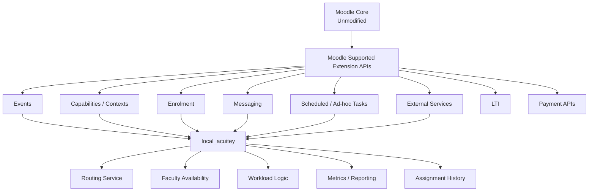

---

## 3. Student Experience Flow

The proposed student lifecycle begins with discovery and enrolment and continues through faculty allocation, learning, assessment, and completion.

```mermaid
flowchart LR
    A[Discover Courses] --> B[Register / Login]
    B --> C[Select Course]
    C --> D{Free or Paid?}

    D -->|Free| E[Enrol]
    D -->|Paid| F[Payment Gateway]
    F --> G[Server-side Verification]
    G -->|Success| E
    G -->|Failed / Pending| H[Retry / Status Check]

    E --> I[Student Dashboard]
    I --> J[Course Access]
    J --> K[Faculty Matching]
    K --> L[Live Learning / Zoom]
    L --> M[Assignments / Assessments]
    M --> N[Progress Tracking]
    N --> O[Completion / Certificate]
```

---

## 4. Automated Student-to-Faculty Routing

This is the main custom Acuitey workflow.

The routing engine does not replace Moodle. Instead, it uses Moodle-supported mechanisms to obtain the student, course, role, enrolment, and permission context, then applies Acuitey-specific business rules.

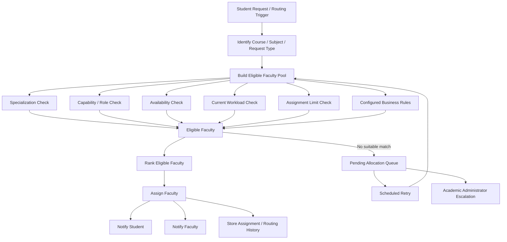

### Routing business rules to confirm

The following remain subject to Acuitey confirmation:

- when faculty allocation should trigger;
- maximum active workload per faculty member;
- how workload should be weighted;
- retry interval for pending allocation;
- escalation SLA;
- whether any ranking preference applies beyond specialization, availability, and workload.

---

## 5. Moodle-Native Routing Integration

The internal routing mechanism should use Moodle-supported extension points rather than modifying core files.

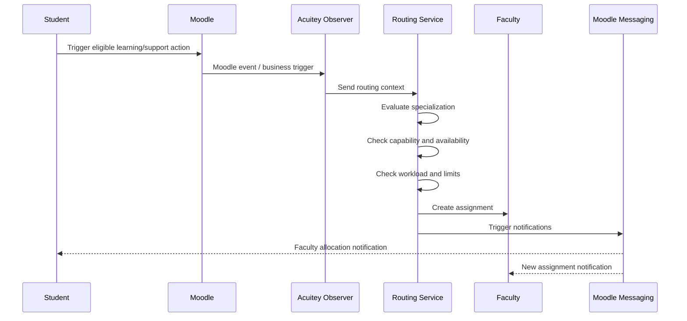

Where routing or follow-up processing is asynchronous, Moodle scheduled tasks or ad-hoc tasks can be used.

---

## 6. Role & Security Model

The platform should use Moodle contexts and capabilities to control access.

Primary roles may include:

- Student
- Faculty
- Academic Administrator
- Finance / Payment Administrator
- Super Administrator

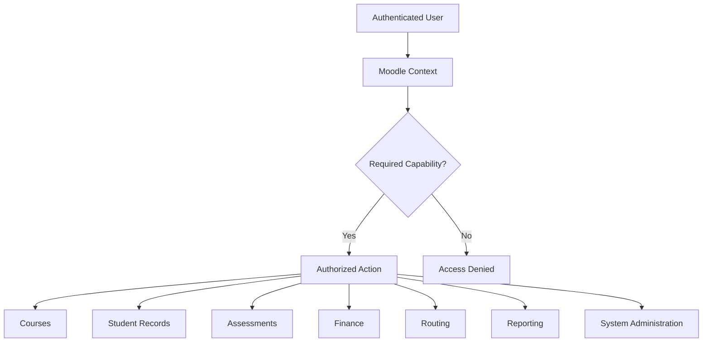

Access must be limited according to role, context, assignment, and business need.

---

## 7. Payment & Enrolment Flow

Razorpay and PhonePe are proposed payment gateway options.

The final implementation should use server-side gateway-specific verification.

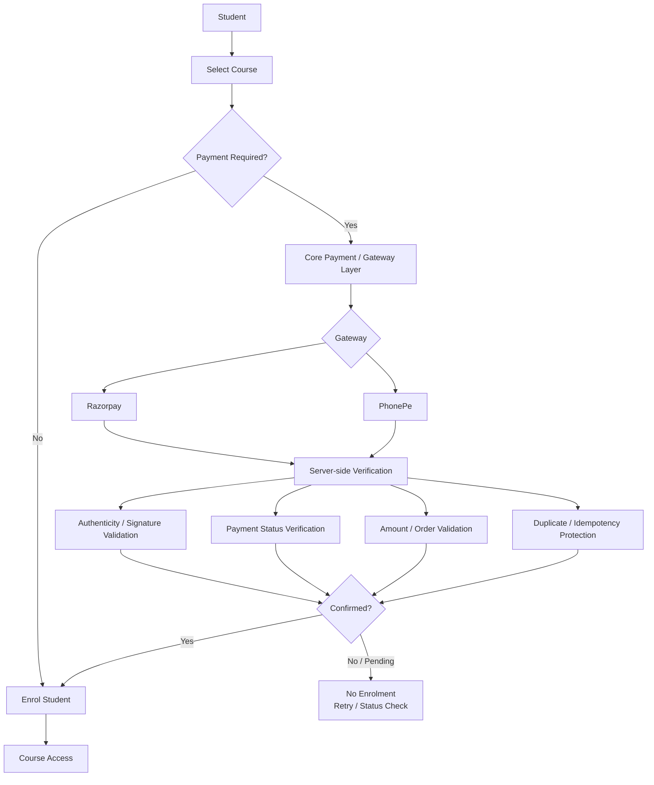

Gateway secrets must remain server-side.

---

## 8. Zoom / Live Learning

Zoom is proposed to integrate using Moodle LTI capabilities.

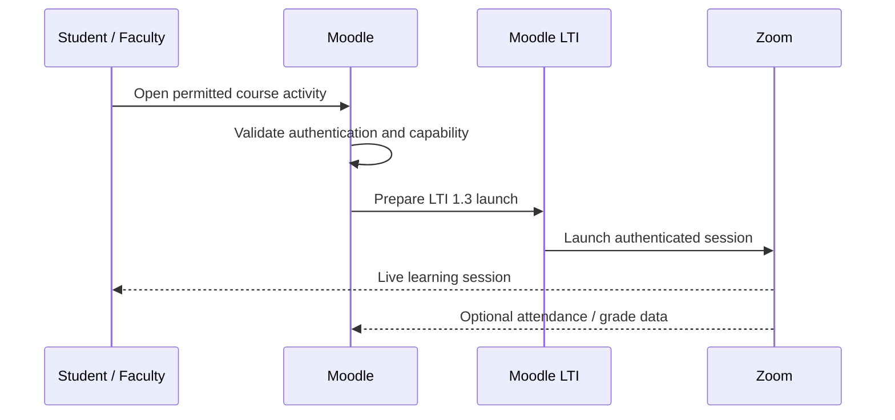

**Note:** Grade and attendance synchronization may be enabled where supported by the selected Zoom LTI configuration and Acuitey’s Zoom account/licensing.

---

## 9. Data Architecture

Moodle remains the primary application layer and accesses the database through its own database abstraction mechanisms.

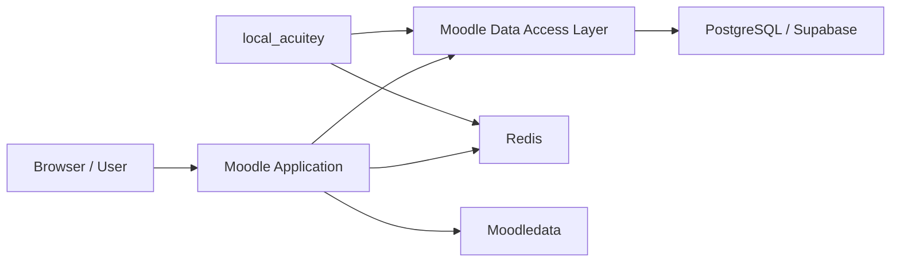

Potential Acuitey-specific data areas may include:

- faculty availability;
- routing configuration;
- routing history;
- workload state;
- custom faculty metrics;
- custom assignment history.

The final schema should be defined only after business rules are confirmed.

---

## 10. Proposed Deployment Architecture & Native Branded Subdomain Strategy

Infrastructure is still subject to final provisioning and configuration. Per client architectural directive **ACU-CR-001**, the Moodle LMS is deployed natively on an Acuitey branded secure subdomain rather than an isolated external domain or standalone link.

### 10.1 High-Level Deployment & Request Flow

The end-to-end request path moves from the Acuitey corporate presence through the edge security perimeter to the application runtime:

```
User (Browser / App)
  ↓
www.acuiteysolutions.com (Main Corporate Website)
  ↓ [Portal Login Navigation CTA]
portal.acuiteysolutions.com  OR  academy.acuiteysolutions.com
  ↓ (Final subdomain to be confirmed by Acuitey — DEC-017)
Acuitey DNS Zone & HTTPS / Edge Layer (Proposed Cloudflare Proxy)
  ↓
Hostinger KVM Host
  ↓
Nginx Reverse Proxy (Virtual Host restriction)
  ↓
PHP-FPM 8.3
  ↓
Moodle Core 5.2.3+ & local_acuitey Extension
  ↓
PostgreSQL / Supabase + Redis 7 + Moodledata (/mnt) + External Services (Zoom / Razorpay / PhonePe)
```

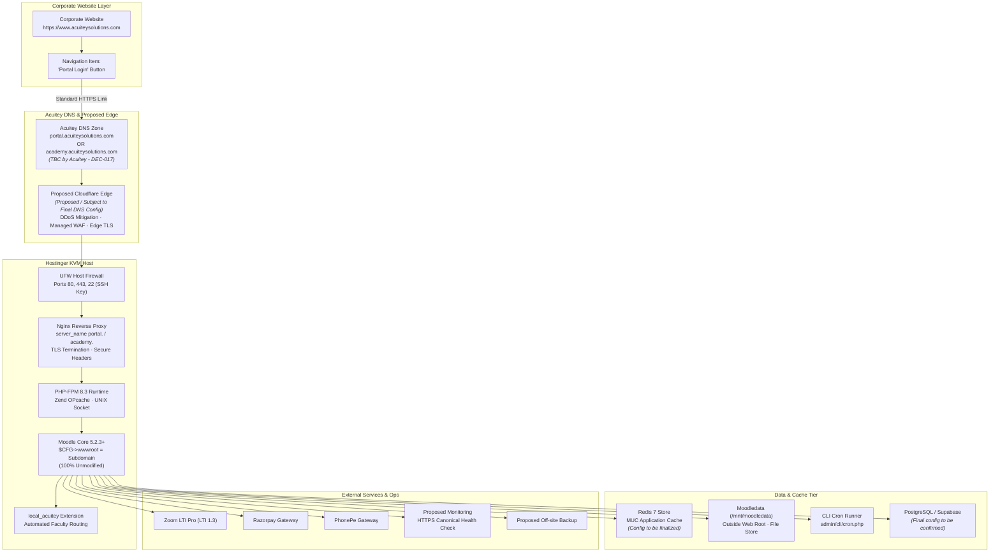

---

### 10.2 Main Corporate Website Integration

The relationship between the Acuitey corporate website and the LMS platform is structured as follows:

- **Corporate Web Origin:** `https://www.acuiteysolutions.com`
- **Primary LMS Access Point:** A clearly positioned **"Portal Login"** action item in the primary site navigation header.
- **Destination:** `https://<approved-lms-subdomain>.acuiteysolutions.com` (either `https://portal.acuiteysolutions.com` or `https://academy.acuiteysolutions.com` pending **DEC-017**).
- **Navigation Standard:** Standard HTTPS browser navigation link (`<a href="https://..." target="_self">`).
- **No Fragile Iframe Embedding:** The LMS **must not** be embedded inside an iframe on `www.acuiteysolutions.com`. Modern browser privacy protections (such as third-party cookie restrictions, partitioned storage, and browser sandbox constraints) severely impair authentication cookies, payment gateways, and Zoom LTI handshakes within embedded frames.
- **Independent Identity Perimeter:** Automatic shared login or Single Sign-On (SSO) between `www.acuiteysolutions.com` and Moodle is **not** assumed. Unless a centralized corporate identity provider (e.g., OpenID Connect, SAML 2.0, or Google Workspace) is separately approved, Moodle operates its own secure user authentication perimeter. The requirement is branded subdomain navigation, not automatic identity federation.

---

### 10.3 DNS & TLS Architecture

The LMS subdomain configuration will adhere to the following architecture standards:

- **DNS Zone Control:** The subdomain record (A/AAAA pointing directly to Hostinger KVM, or CNAME to Cloudflare proxy) is created and managed exclusively within Acuitey’s authoritative DNS zone.
- **Enforced HTTPS & Automated Redirection:** All plaintext HTTP traffic on port 80 is unconditionally redirected to HTTPS on port 443 with an HTTP 301 Permanent Redirect.
- **Valid TLS Certificate:** A valid TLS certificate with modern TLS configuration (TLS 1.2/1.3 as supported) must be provisioned and active for the selected subdomain before public launch.
- **HTTP Strict Transport Security (HSTS):** HSTS headers (`Strict-Transport-Security: max-age=31536000; includeSubDomains`) will be enabled **only after full production validation** to prevent accidental domain-wide lockouts during onboarding.
- **No Public Raw IP Access:** Direct HTTP/HTTPS access to the origin server using its public IPv4 address is blocked at both the edge and Nginx virtual host levels.
- **Canonical Moodle `wwwroot` Configuration:** Moodle requires an exact canonical URL declaration in its configuration file. Conceptually documented pending **DEC-017** selection:

```php
// CONCEPTUAL CONFIGURATION — DO NOT MODIFY config.php BEFORE DEC-017 IS CONFIRMED
// Option A:
$CFG->wwwroot = 'https://portal.acuiteysolutions.com';

// Option B:
// $CFG->wwwroot = 'https://academy.acuiteysolutions.com';
```

*(Note: Production `config.php` remains unmodified until DEC-017 is formally approved.)*

---

### 10.4 Nginx Virtual Host & Server Access Rules

The proposed production Nginx server configuration on the Hostinger KVM instance will enforce strict hostname-based routing and hardening:

- **Virtual Host Hostname Binding:** Nginx will be configured to accept and serve traffic exclusively for the approved Acuitey LMS hostname:

```nginx
# CONCEPTUAL NGINX VHOST CONFIGURATION (DOCUMENTATION ONLY - NOT YET DEPLOYED)
# Pending client decision DEC-017:
server {
    listen 443 ssl http2;
    listen [::]:443 ssl http2;
    server_name portal.acuiteysolutions.com; # OR: academy.acuiteysolutions.com;

    # Document Root (Moodle public codebase)
    root /var/www/moodle;
    index index.php index.html index.htm;

    # TLS Configuration
    ssl_protocols TLSv1.2 TLSv1.3;
    ssl_prefer_server_ciphers off;

    # Security Headers
    add_header X-Frame-Options "SAMEORIGIN" always;
    add_header X-Content-Type-Options "nosniff" always;
    add_header X-XSS-Protection "1; mode=block" always;
    add_header Referrer-Policy "strict-origin-when-cross-origin" always;
    add_header Permissions-Policy "camera=(self), microphone=(self), geolocation=()" always;

    # Deny direct access to Moodledata & hidden dotfiles
    location ~ ^/(moodledata|\.git|\.env|composer\.json) {
        deny all;
        return 404;
    }

    # Pass PHP scripts to PHP-FPM 8.3 via UNIX domain socket
    location ~ [^/]\.php(/|$) {
        fastcgi_split_path_info ^(.+\.php)(/.+)$;
        fastcgi_pass unix:/run/php/php8.3-fpm.sock;
        fastcgi_index index.php;
        include fastcgi_params;
        fastcgi_param SCRIPT_FILENAME $document_root$fastcgi_script_name;
        fastcgi_param PATH_INFO $fastcgi_path_info;
    }

    # Disable directory indexing
    autoindex off;
}

# Catch-all default block to drop unsolicited raw-IP requests or unknown host headers
server {
    listen 80 default_server;
    listen [::]:80 default_server;
    listen 443 ssl default_server;
    listen [::]:443 ssl default_server;
    server_name _;
    ssl_reject_handshake on; # Drops raw-IP TLS probes immediately
    return 444;              # Closes connection without response
}
```

- **Moodledata Isolation:** The persistent storage directory (`/mnt/moodledata`) is placed completely outside the Nginx web root (`/var/www/moodle`) and is never directly accessible via web requests.
- **Directory Browsing Disabled:** `autoindex off;` is enforced globally.
- **Unintended Host Header Rejection:** Unmatched or raw-IP requests are dropped without processing.

*(Note: Production Nginx configurations will not be deployed until DEC-017 is confirmed and server provisioning begins.)*

---

### 10.5 Session & Cookie Boundary

To preserve platform isolation and prevent security cross-contamination:

- **Host-Scoped Cookies:** Moodle session cookies (`MoodleSession`) should be host-scoped to the specific LMS hostname (`portal.acuiteysolutions.com` or `academy.acuiteysolutions.com`).
- **Session Scope & Cookie Isolation:** Moodle sessions should remain host-scoped unless a future reviewed SSO requirement requires otherwise. This avoids creating an unnecessary architectural prohibition before identity/SSO requirements are known, while ensuring clean session isolation by default.
- **Independent Session Lifecycle:** Authentication states on `www.acuiteysolutions.com` and the Moodle LMS remain completely independent. Logging into or out of the LMS does not impact public website sessions.

---

### 10.6 Proposed Cloudflare Edge & Proxy Topology (Proposed Architecture)

If Cloudflare is adopted as the edge network:

```
Acuitey DNS Zone
      ↓
LMS Subdomain Record (portal. or academy.)
      ↓
Proposed Cloudflare Edge Proxy (WAF / DDoS / TLS Termination)
      ↓ (Strict TLS Origin Pull)
Hostinger KVM Origin Server (Nginx)
```

- **Governance Status:** Cloudflare, Edge WAF, and DDoS mitigation are **PROPOSED / SUBJECT TO FINAL DNS CONFIGURATION**. They have not been provisioned or explicitly approved, and remain an architectural proposal pending formal client sign-off.
- **Reverse Proxy Headers:** If Cloudflare is approved and enabled, Nginx and Moodle must be configured to safely extract the client's genuine IP address from `CF-Connecting-IP` or `X-Forwarded-For`.
- **Trusted Proxy Configuration in Moodle:** Moodle's `$CFG->reverseproxy = true;` and `$CFG->sslproxy = true;` will be configured alongside verified Cloudflare origin IP ranges to prevent IP-spoofing attacks.

---

### 10.7 Health Checks & Monitoring Architecture

Operational telemetry and availability monitors must reference the canonical LMS HTTPS hostname rather than server IP addresses:

- **Primary Public Health Probe:** `https://portal.acuiteysolutions.com` OR `https://academy.acuiteysolutions.com` (testing HTTP 200/303 responses on canonical endpoints).
- **Synthetic Availability Monitors:** External uptime checks (e.g., UptimeRobot, Better Uptime) monitor SSL validity, DNS resolution latency, and HTTP response codes targeting the approved hostname.
- **Internal Host Metrics:** Prometheus Node Exporter and PHP-FPM status monitors run locally on Hostinger KVM and communicate over private interfaces.
- **Endpoint Finalization:** Monitoring targets will remain parameterized until **DEC-017** is resolved.

---

### 10.8 Infrastructure Security Review Checklist

Before opening the LMS subdomain to production users, the following 12-point security review must be completed and signed off:

1. **Enforce HTTPS Exclusively:** Verify that all HTTP requests redirect seamlessly to HTTPS without intermediary plaintext exposure.
2. **Authoritative DNS Zone Ownership:** Verify that the DNS A/CNAME record is provisioned inside Acuitey’s official domain registrar/DNS management zone.
3. **Valid TLS Certificate Chain:** Validate TLS certificate authenticity, intermediate bundle completeness, modern TLS configuration (TLS 1.2/1.3 as supported), and automated renewal triggers.
4. **Restricted Virtual Host Binding:** Ensure Nginx responds solely to the selected subdomain and rejects unmapped host headers.
5. **No Public Raw-IP Access:** Confirm that accessing `http://<server-ip>` or `https://<server-ip>` immediately drops the connection or returns HTTP 444/403.
6. **Canonical Moodle `wwwroot` Synchronization:** Verify that `$CFG->wwwroot` precisely matches the public HTTPS subdomain.
7. **Secure Cookie Enforcements:** Confirm that `MoodleSession` cookies are issued with `Secure` and `HttpOnly` attributes.
8. **SameSite Cookie Audit:** Verify that `SameSite` settings (Lax default) support embedded LTI 1.3 workflows (e.g., Zoom launch if frame-based launch is selected).
9. **Reverse Proxy & Client IP Handling:** If Cloudflare is active, verify that client IP addresses are correctly reported in Moodle logs (`\core\session\manager`).
10. **Trusted Proxy CIDR Isolation:** Ensure reverse proxy trust is restricted strictly to verified Cloudflare or edge IP ranges.
11. **Redirect Loop Prevention:** Verify that edge-to-origin SSL handshakes (`Strict` mode) do not trigger infinite HTTP $\leftrightarrow$ HTTPS redirection loops.
12. **Canonical Authentication Verification:** Thoroughly test learner and instructor login, session persistence, and logout flows directly on the canonical hostname.

---

## 11. Native Moodle vs Acuitey Custom Development

| Area | Approach |
|---|---|
| Authentication | Native Moodle |
| Users and roles | Native Moodle |
| Capabilities and contexts | Native Moodle |
| Course structure | Native Moodle |
| Enrolment | Native Moodle / integration |
| Assignments and quizzes | Native Moodle |
| Grades and completion | Native Moodle |
| Events | Native Moodle |
| Messaging | Native Moodle |
| Background tasks | Native Moodle |
| Faculty routing | Acuitey custom |
| Faculty availability | Acuitey custom |
| Workload balancing | Acuitey custom |
| Custom faculty metrics | Acuitey custom |
| Razorpay | Payment integration |
| PhonePe | Payment integration |
| Zoom | LTI integration |
| Acuitey dashboards | Hybrid / custom presentation |

---

## 12. Proposed Implementation Sequence

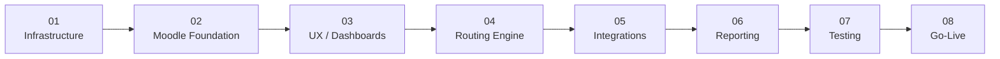

### Phase 1 — Infrastructure

- Hostinger KVM provisioning
- server hardening
- Nginx / PHP-FPM
- database connectivity
- Redis
- SSL
- Moodle cron
- backup foundation

### Phase 2 — Moodle Foundation

- Moodle configuration
- Acuitey branding/theme foundation
- roles and capabilities
- user structure
- course structure
- enrolment model

### Phase 3 — UX & Dashboards

- homepage
- course catalogue
- student dashboard
- faculty dashboard

### Phase 4 — Routing Engine

- faculty profile/routing data
- availability
- workload
- routing rules
- assignment history
- fallback queue
- notifications

### Phase 5 — Integrations

- Zoom / LTI
- Razorpay
- PhonePe
- any approved external APIs

### Phase 6 — Reporting

- student reporting
- faculty metrics
- routing analytics
- administrative reporting

### Phase 7 — Testing

- functional
- security
- roles/permissions
- routing
- payment
- Zoom
- performance

### Phase 8 — Go-Live

- final configuration
- production deployment
- monitoring
- backup verification
- release

---

## 13. Items Requiring Acuitey Confirmation

1. **Routing Trigger**  
   Confirm whether faculty allocation occurs after enrolment, on first learning activity, or when the student explicitly requests mentoring/support.

2. **Faculty Capacity**  
   Confirm maximum concurrent workload and any workload weighting rules.

3. **Routing Escalation**  
   Confirm retry interval and Academic Administrator escalation SLA for pending allocation requests.

4. **Payment Configuration**  
   Confirm whether Razorpay and PhonePe should both be available simultaneously or whether one will be primary.

5. **Zoom Configuration**  
   Confirm Acuitey’s Zoom account/licensing and the LTI Pro features enabled for the account.

6. **Database Configuration**  
   Confirm whether the production database will use managed Supabase PostgreSQL or another PostgreSQL deployment model.

7. **LMS Production Subdomain Selection (DEC-017)**  
   Confirm whether the production LMS will be hosted at `portal.acuiteysolutions.com` or `academy.acuiteysolutions.com`. Status: `CLIENT FINAL HOSTNAME CONFIRMATION REQUIRED`. Blocking before infrastructure production configuration; non-blocking for local development and design.

---

## 14. Architecture Confirmation

The proposed Acuitey automated student-to-faculty workflow will be implemented using Moodle's supported extension architecture.

**Moodle core files will not be modified for this functionality.**

Moodle APIs, events, capabilities, tasks, messaging, enrolment information, and other supported extension mechanisms will be used where appropriate.

Acuitey-specific routing logic will remain isolated within controlled custom extensions.

Third-party Moodle plugins will only be introduced where they provide a justified and maintainable capability that is not appropriately delivered through Moodle-native functionality or the Acuitey custom extension.

---

**Companion PDF:** `Acuitey-LMS-Initial-System-Design-Editorial.pdf`
